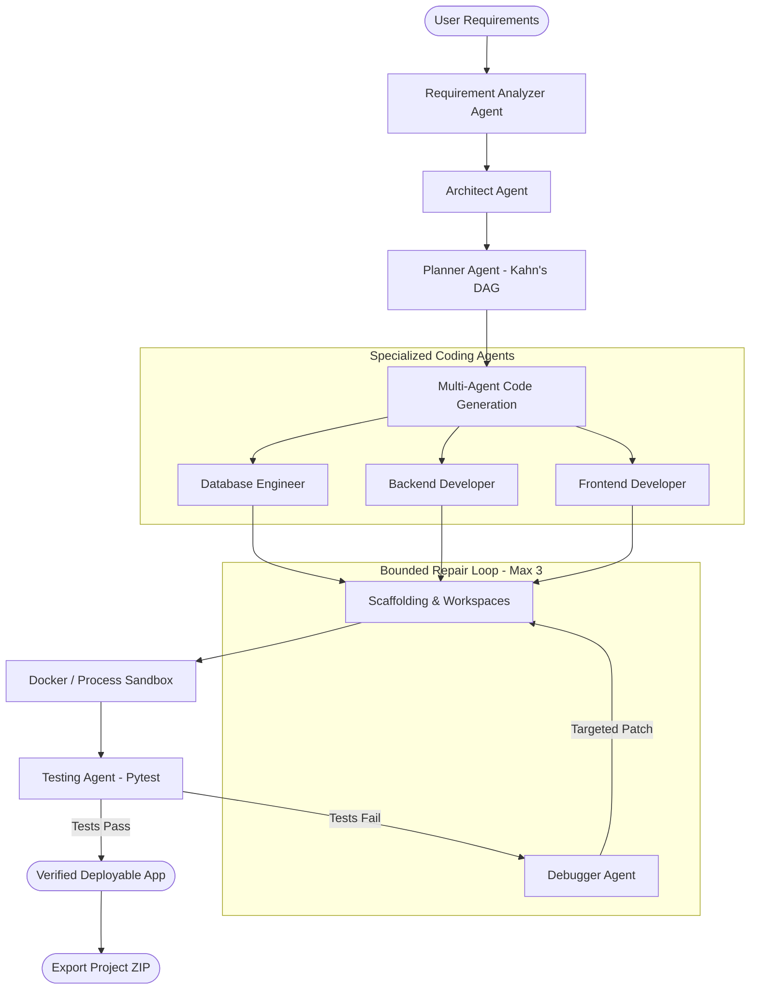

# ORCHESTRIX ◈
### Autonomous AI Software Engineering & Verification Platform

[](https://www.python.org/)
[](https://fastapi.tiangolo.com/)
[](https://nextjs.org/)
[](https://www.postgresql.org/)
[](https://docs.pytest.org/)
[](https://ollama.com/)

> **From Idea to Production-Ready Software. Autonomously.**  
> Orchestrix is an AI-powered multi-agent software engineering platform that transforms natural-language software requirements into functional, tested, containerized, and self-healing web applications.

---

## 🏛️ System Architecture

Orchestrix replaces passive LLM chatbots with a deterministic engineering pipeline coupled to an active verification and self-healing loop:



---

## 🤖 The 8 Specialized AI Agents

Every agent operates with typed Pydantic contracts and dedicated responsibilities:

| # | Agent | Role | Artifacts & Output |
|---|---|---|---|
| **01** | **Requirement Analyzer** | Synthesizes natural-language prompts into formal specs | `requirements.json` |
| **02** | **Architect Agent** | Designs system patterns, entities, and API contracts | `architecture.json` |
| **03** | **Planner Agent** | Decomposes architecture into dependency DAG waves | `task_plan.json` |
| **04** | **Database Engineer** | Generates SQLAlchemy 2.x models and Alembic migrations | `app/models/`, `migrations/` |
| **05** | **Backend Developer** | Generates FastAPI routers, CRUD services, and JWT auth | `app/api/`, `app/services/` |
| **06** | **Frontend Developer** | Builds Next.js 14 pages, Tailwind components, and types | `app/`, `components/` |
| **07** | **Testing Agent** | Generates Pytest suites and executes sandboxed test runs | `tests/test_api.py` |
| **08** | **Debugger Agent** | Diagnoses stack traces and applies self-healing patches | `self_healing_patch` |

---

## ⚡ Closed-Loop Self-Healing Engine

When tests fail inside the isolated sandbox:
1. **Diagnosis**: Debugger Agent inspects failing assertion traces and source files.
2. **Patch Synthesis**: Generates targeted, full-file corrections.
3. **Application & Verification**: Writes fixes, recalculates SHA-256 integrity hashes in PostgreSQL, and re-executes sandboxed tests.
4. **Bounded Safety**: Bounded to a maximum of 3 iterations to prevent runaway LLM loops.

---

## 🛠️ Technology Stack

- **Backend**: Python 3.13, FastAPI, Pydantic v2, Uvicorn
- **AI Orchestration**: LangChain, LangGraph, Ollama (`qwen2.5-coder:7b`)
- **Database & ORM**: PostgreSQL 18, SQLAlchemy 2.x, Alembic Migrations
- **Frontend**: Next.js 14 (App Router), TypeScript, Tailwind CSS, `@xyflow/react` (React Flow), Lucide Icons
- **Sandboxed Execution**: Docker containers (CPU/memory constrained) & Local Process Sandbox (timeout bounded)
- **Testing & QA**: Pytest 8.x, HTTPX TestClient

---

## 🚀 Quickstart Guide

### Prerequisites
- Python 3.13+
- Node.js 18+ and npm
- PostgreSQL 16+
- Ollama with model `qwen2.5-coder:7b` (`ollama run qwen2.5-coder:7b`)
- Docker Desktop (Optional, for containerized sandbox)

### 1. Backend Setup
```bash
# Clone the repository
git clone https://github.com/Nimalan07/orchestrix-ai.git
cd orchestrix-ai/backend

# Create virtual environment
python -m venv venv
# On Windows:
.\venv\Scripts\activate
# On Linux/macOS:
source venv/bin/activate

# Install dependencies
pip install -r requirements.txt

# Run database migrations
alembic upgrade head

# Start FastAPI server
uvicorn app.main:app --host 0.0.0.0 --port 8000 --reload
```
API Documentation will be live at: `http://localhost:8000/docs`

### 2. Frontend Setup
```bash
cd ../frontend

# Install dependencies
npm install

# Start development server
npm run dev
```
Orchestrix Platform will be live at: `http://localhost:3000`

### 3. One-Command Docker Deployment (Production)
To deploy the entire Orchestrix platform (PostgreSQL, FastAPI Backend, and Next.js Frontend) in unified containers:
```bash
# Clone and launch all services
docker compose up --build -d
```
- **Dashboard**: `http://localhost:3000`
- **Swagger API Docs**: `http://localhost:8000/docs`
- **Database**: PostgreSQL on port `5432` (persistent Docker volume `pgdata`)

---

## 🧪 Automated Test Suite

To run all 45 automated integration and unit tests:
```bash
pytest -v
```
```text
============================= 45 passed in 4.99s ==============================
```

---

## 📡 REST API Reference

| Method | Endpoint | Description |
|---|---|---|
| `POST` | `/api/projects` | Initialize a new engineering project |
| `GET` | `/api/projects` | List all active projects in PostgreSQL |
| `POST` | `/api/projects/{id}/analyze` | Trigger Requirement Analyzer Agent |
| `POST` | `/api/projects/{id}/architect` | Synthesize system architecture and contracts |
| `POST` | `/api/projects/{id}/plan` | Compute topological task DAG waves |
| `POST` | `/api/projects/{id}/generate` | Run multi-agent code generation |
| `POST` | `/api/projects/{id}/execute` | Run sandboxed tests & autonomous self-healing |
| `GET` | `/api/projects/{id}/runs` | Retrieve execution history and logs |
| `GET` | `/api/projects/{id}/files` | List generated workspace files |
| `GET` | `/api/projects/{id}/export` | Download workspace as a clean ZIP archive |

---

## 🔒 Security & Containment

- **Path Traversal Protection**: All file writes are strictly constrained to `generated_projects/<slug>/` via `relative_to` verification.
- **Environment Scrubbing**: Process sandboxes run with sanitized environment variables, preventing credential leaks.
- **Resource Constraints**: Docker sandbox limits containers to 1.0 CPU core and 512MB RAM with non-root user execution.

---

## 📄 License
MIT License. Built with passion for autonomous software engineering.
